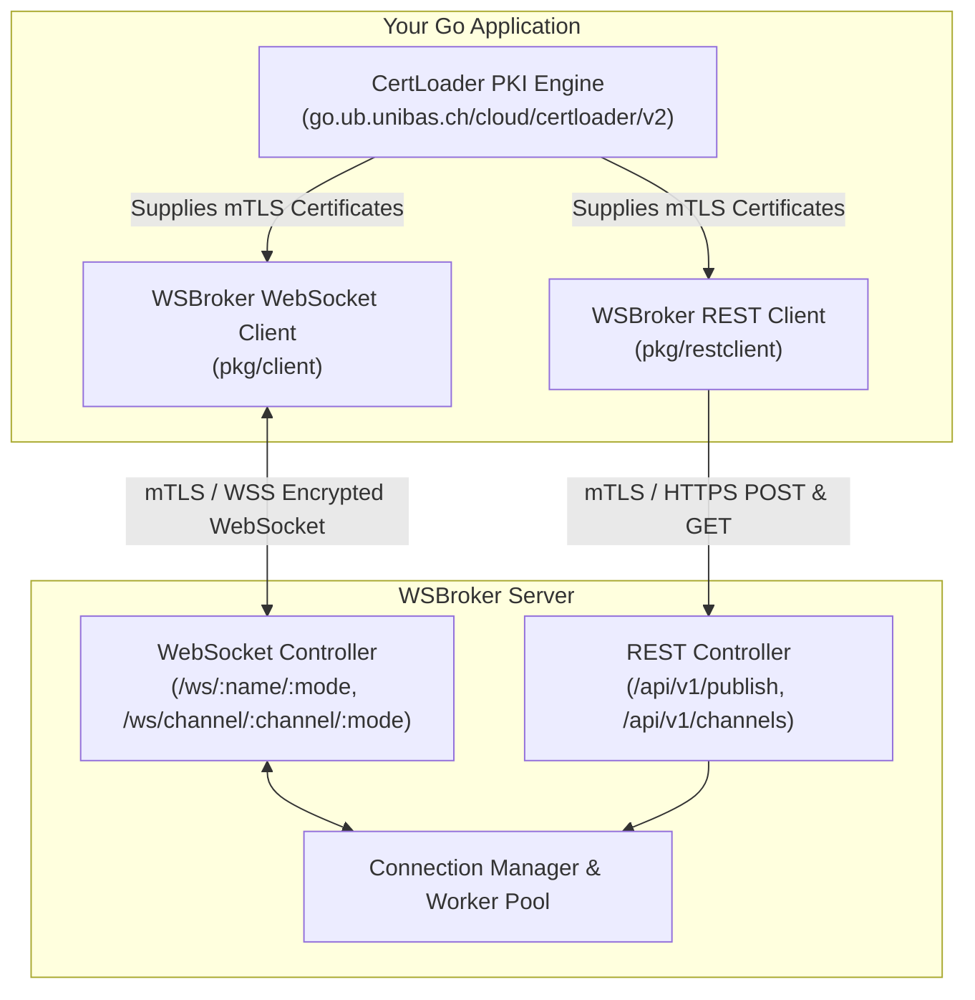
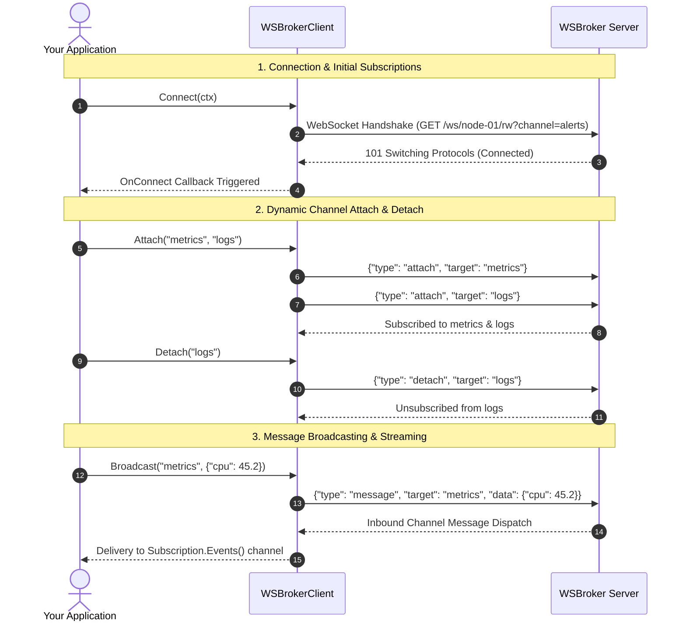
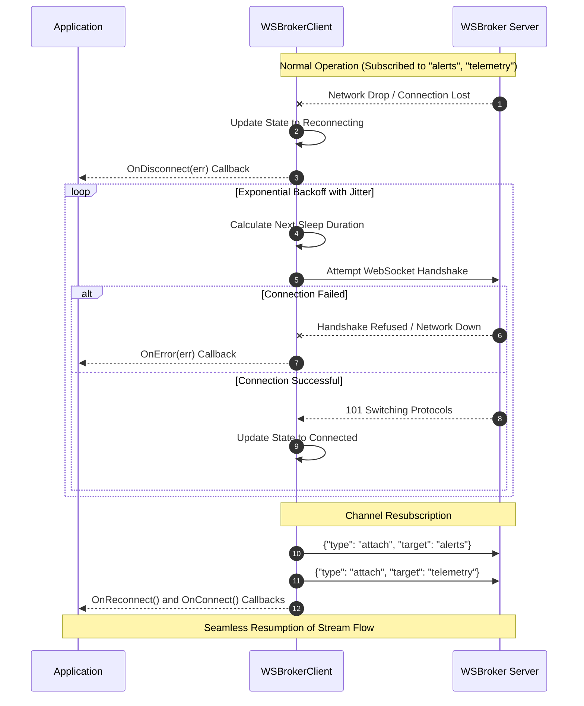
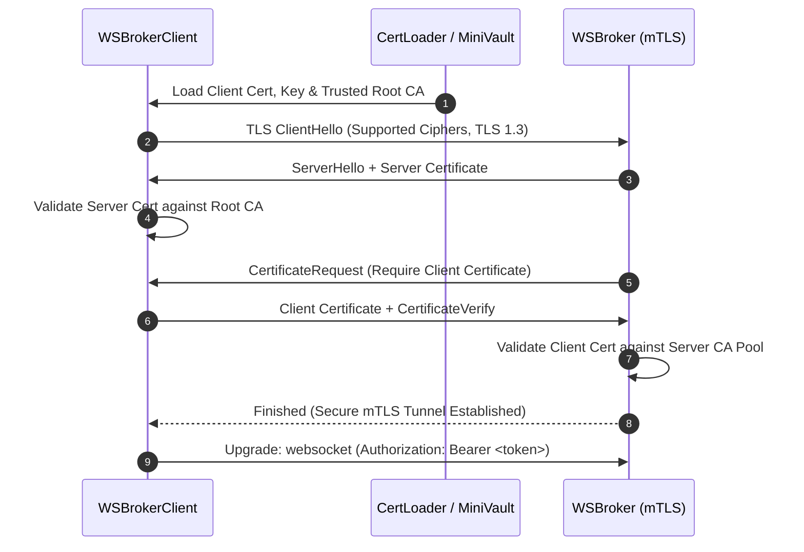

# WSBrokerClient

[](https://pkg.go.dev/github.com/je4/wsbrokerclient)
[](LICENSE)

**WSBrokerClient** is an enterprise-grade Go client library for [WSBroker](https://github.com/je4/wsbroker). It provides seamless WebSocket and REST integration, robust mutual TLS (mTLS) certificate management with hot-reloading via [`certloader`](https://go.ub.unibas.ch/cloud/certloader), jittered exponential backoff auto-reconnection, dynamic pub/sub channel state management, and stream subscriptions.

---

## Table of Contents

- [Features](#features)
- [Architecture & Diagrams](#architecture--diagrams)
  - [System Architecture](#system-architecture)
  - [Connection & Channel Lifecycle](#connection--channel-lifecycle)
  - [Automatic Reconnection & Resubscription Flow](#automatic-reconnection--resubscription-flow)
  - [mTLS Handshake & Security Model](#mtls-handshake--security-model)
- [Installation](#installation)
- [Quick Start](#quick-start)
- [Security & mTLS Configuration](#security--mtls-configuration)
  - [mTLS via `certloader` (MiniVault, File, Env, Dev)](#mtls-via-certloader-minivault-file-env-dev)
  - [mTLS via standard `crypto/tls`](#mtls-via-standard-cryptotls)
  - [Bearer Token Authentication](#bearer-token-authentication)
- [Core Usage Guide](#core-usage-guide)
  - [Dynamic Channel Subscriptions & Streaming](#dynamic-channel-subscriptions--streaming)
  - [Event Handlers & Callbacks](#event-handlers--callbacks)
  - [Direct Client-to-Client Messaging](#direct-client-to-client-messaging)
  - [Publishing & Broadcasting](#publishing--broadcasting)
  - [Heartbeat & Ping/Pong Handling](#heartbeat--pingpong-handling)
- [REST Management API Client](#rest-management-api-client)
- [Configuration Reference](#configuration-reference)
- [License](#license)

---

## Features

- **High-Performance WebSocket Engine:** Powered by [`coder/websocket`](https://github.com/coder/websocket) with concurrent-safe write synchronization and context-aware timeouts.
- **Enterprise mTLS Security:** Full integration with `go.ub.unibas.ch/cloud/certloader/v2` supporting dynamic hot-reloading of client certificates, MiniVault PKI, local file pairs, environment variables, or standard Go `*tls.Config`.
- **Intelligent Auto-Reconnection:** Built-in connection supervisor with jittered exponential backoff and transparent channel resubscription upon network restore.
- **Dynamic Pub/Sub & Stream Subscriptions:** Join/leave channels dynamically, consume channel events via Go channels (`Subscription.Events()`), or register target/type-specific handlers.
- **Direct Point-to-Point Messaging:** Send targeted events directly to specific connected clients.
- **Automatic Heartbeat Management:** Responds to server pings with standard pong envelopes and sends periodic client-side keepalive pings.
- **RESTful Client Included:** Full HTTP client implementation for WSBroker REST management endpoints (`/api/v1/publish`, `/api/v1/channels`, `/api/v1/clients`, etc.).

---

## Architecture & Diagrams

### System Architecture



---

### Connection & Channel Lifecycle



---

### Automatic Reconnection & Resubscription Flow



---

### mTLS Handshake & Security Model



---

## Installation

```bash
go get github.com/je4/wsbrokerclient
```

---

## Quick Start

```go
package main

import (
	"context"
	"fmt"
	"time"

	"github.com/je4/wsbrokerclient"
)

type SensorTelemetry struct {
	DeviceID    string  `json:"device_id"`
	Temperature float64 `json:"temperature"`
	Humidity    float64 `json:"humidity"`
}

func main() {
	ctx := context.Background()

	// 1. Initialize Client
	cli, err := wsbrokerclient.New(wsbrokerclient.DefaultConfig(),
		wsbrokerclient.WithEndpoint("ws://localhost:8080"),
		wsbrokerclient.WithClientName("sensor-node-01"),
		wsbrokerclient.WithInitialChannels("telemetry", "alerts"),
		wsbrokerclient.WithAutoReconnect(true),
	)
	if err != nil {
		panic(err)
	}
	defer cli.Close()

	// 2. Stream-based subscription
	sub, err := cli.Subscribe(ctx, "telemetry")
	if err != nil {
		panic(err)
	}
	defer sub.Unsubscribe()

	go func() {
		for evt := range sub.Events() {
			var data SensorTelemetry
			if err := evt.UnmarshalData(&data); err == nil {
				fmt.Printf("[%s] Temp: %.1f°C, Humidity: %.1f%%\n", data.DeviceID, data.Temperature, data.Humidity)
			}
		}
	}()

	// 3. Connect to WSBroker
	if err := cli.Connect(ctx); err != nil {
		panic(err)
	}

	// 4. Broadcast sensor data
	_ = cli.Broadcast(ctx, "telemetry", SensorTelemetry{
		DeviceID:    "sensor-node-01",
		Temperature: 22.4,
		Humidity:    48.0,
	})

	time.Sleep(2 * time.Second)
}
```

---

## Security & mTLS Configuration

### mTLS via `certloader` (MiniVault, File, Env, Dev)

WSBrokerClient directly integrates with [`go.ub.unibas.ch/cloud/certloader/v2`](https://go.ub.unibas.ch/cloud/certloader). It handles dynamic client certificates with automatic hot-reloading:

```go
import (
	"github.com/je4/wsbrokerclient"
	"go.ub.unibas.ch/cloud/certloader/v2/pkg/loader"
)

// Example: File-based mTLS
certConfig := &loader.Config{
	Type: "FILE",
	File: &loader.FileConfig{
		Cert: "/etc/ssl/certs/client.cert.pem",
		Key:  "/etc/ssl/private/client.key.pem",
		CA:   []string{"/etc/ssl/certs/ca.crt"},
	},
}

cli, err := wsbrokerclient.New(wsbrokerclient.DefaultConfig(),
	wsbrokerclient.WithEndpoint("wss://broker.internal.org:8080"),
	wsbrokerclient.WithClientName("service-a"),
	wsbrokerclient.WithTLSCertLoader(certConfig),
)
```

### mTLS via standard `crypto/tls`

```go
import (
	"crypto/tls"
	"crypto/x509"
	"os"

	"github.com/je4/wsbrokerclient"
)

cert, _ := tls.LoadX509KeyPair("client.crt", "client.key")
caCert, _ := os.ReadFile("ca.crt")
caPool := x509.NewCertPool()
caPool.AppendCertsFromPEM(caCert)

tlsConfig := &tls.Config{
	Certificates: []tls.Certificate{cert},
	RootCAs:      caPool,
	MinVersion:   tls.VersionTLS13,
}

cli, err := wsbrokerclient.New(wsbrokerclient.DefaultConfig(),
	wsbrokerclient.WithEndpoint("wss://localhost:8080"),
	wsbrokerclient.WithTLSConfig(tlsConfig),
)
```

### Bearer Token Authentication

```go
cli, err := wsbrokerclient.New(wsbrokerclient.DefaultConfig(),
	wsbrokerclient.WithEndpoint("wss://localhost:8080"),
	wsbrokerclient.WithBearerToken("your-secure-bearer-token"),
)
```

---

## Core Usage Guide

### Dynamic Channel Subscriptions & Streaming

```go
// Stream subscription using Go channel
sub, err := cli.Subscribe(ctx, "orders")
if err != nil {
	log.Fatal(err)
}
defer sub.Unsubscribe()

for evt := range sub.Events() {
	fmt.Printf("Received order event: %s\n", evt.String())
}

// Or manually attach/detach channels
_ = cli.Attach(ctx, "notifications", "billing")
_ = cli.Detach(ctx, "billing")
```

### Event Handlers & Callbacks

```go
// Listen to all messages targeted to "alerts" channel
cli.OnChannel("alerts", func(evt *wsbrokerclient.Event) {
	fmt.Println("Alert received:", evt)
})

// Listen to direct messages sent to this client
cli.OnDirect(func(evt *wsbrokerclient.Event) {
	fmt.Printf("Direct message from %s: %s\n", evt.Source, evt.Data)
})

// Connection lifecycle callbacks
cli.OnConnect(func() {
	fmt.Println("Connected to WSBroker!")
})

cli.OnDisconnect(func(err error) {
	fmt.Printf("Disconnected from WSBroker: %v\n", err)
})

cli.OnReconnect(func() {
	fmt.Println("Successfully reconnected and re-subscribed!")
})
```

### Direct Client-to-Client Messaging

```go
// Send a direct message to a specific client identifier ("worker-42")
err := cli.SendDirect(ctx, "worker-42", map[string]string{
	"task": "process_chunk",
	"chunk_id": "9812",
})
```

### Publishing & Broadcasting

```go
// Broadcast structured JSON to all subscribers of "events"
err := cli.Broadcast(ctx, "events", map[string]any{
	"event": "user_signup",
	"user_id": 1042,
})
```

---

## REST Management API Client

WSBrokerClient includes a dedicated REST API client for interacting with WSBroker's administrative endpoints:

```go
import (
	"context"
	"fmt"

	"github.com/je4/wsbrokerclient"
)

func main() {
	ctx := context.Background()

	restCli, err := wsbrokerclient.NewRESTClient(wsbrokerclient.RESTConfig{
		BaseURL: "https://localhost:8080",
		Bearer:  "secret-token",
		// TLSCertLoader or TLSConfig can also be configured here for mTLS REST access
	})
	if err != nil {
		panic(err)
	}
	defer restCli.Close()

	// 1. Health-check
	pong, _ := restCli.Ping(ctx)
	fmt.Println("Ping status:", pong)

	// 2. Publish to channel
	resp, _ := restCli.PublishToChannel(ctx, "alerts", "rest-admin", "Maintenance scheduled")
	fmt.Printf("Published to %d subscribers\n", resp.Subscribers)

	// 3. List active channels
	channels, _ := restCli.GetChannels(ctx)
	for _, ch := range channels {
		fmt.Printf("Channel %s: %d active clients\n", ch.Name, ch.Subscribers)
	}

	// 4. Force disconnect a client
	_ = restCli.DisconnectClient(ctx, "bad-client-node")
}
```

---

## Configuration Reference

### Client Configuration (`client.Config`)

| Field | Type | Default | Description |
| :--- | :--- | :--- | :--- |
| `Endpoint` | `string` | `""` | Target server URL (e.g. `wss://localhost:8080`). |
| `ClientName` | `string` | Auto-generated | Unique client identifier. |
| `InitialChannels` | `[]string` | `nil` | Channels to subscribe to upon connection. |
| `Mode` | `ConnectionMode` | `ModeRW` ("rw") | Access permission mode: `ModeRW` ("rw"), `ModeRO` ("ro"), or `ModeWO` ("wo"). |
| `Bearer` | `string` | `""` | Bearer authentication token. |
| `TLSConfig` | `*tls.Config` | `nil` | Custom standard TLS configuration. |
| `TLSCertLoader` | `*loader.Config`| `nil` | Dynamic mTLS certificate loader config. |
| `AutoReconnect` | `bool` | `true` | Enables automatic reconnection on disconnect. |
| `ReconnectInterval` | `time.Duration` | `1s` | Initial wait duration for reconnect attempts. |
| `MaxReconnectInterval` | `time.Duration` | `30s` | Maximum exponential backoff interval. |
| `ReconnectBackoffFactor`| `float64` | `1.5` | Backoff multiplier per attempt. |
| `MaxReconnectAttempts` | `int` | `0` (infinite)| Max reconnection retries before stopping. |
| `PingInterval` | `time.Duration` | `20s` | Periodic heartbeat ping interval (0 = disabled).|
| `ConnectTimeout` | `time.Duration` | `10s` | Timeout for connection handshake. |
| `WriteTimeout` | `time.Duration` | `5s` | Timeout for writing frames. |

---

## License

Copyright © 2024-2026 Jürgen Enge / Universitätsbibliothek Basel.

Licensed under the [Apache License, Version 2.0](LICENSE).
