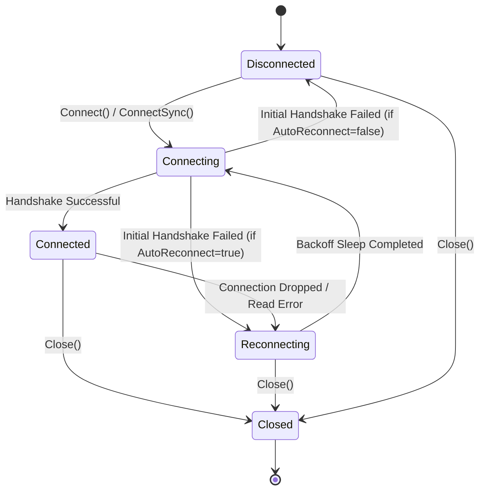

# Package Client (`pkg/client`)

`pkg/client` implements the core WebSocket client for WSBroker with comprehensive mTLS security, background automatic reconnection, channel subscription state persistence, concurrent-safe event dispatching, and stream subscriptions.

## Features

- **Dynamic mTLS Authentication:** Full support for `go.ub.unibas.ch/cloud/certloader/v2` dynamic certificate loaders and standard `*crypto/tls.Config`.
- **Automatic Reconnection with Jittered Exponential Backoff:** Automatically re-establishes dropped connections and re-attaches to all subscribed channels.
- **Dynamic Pub/Sub & Streaming:** Go-channel stream subscriptions (`Subscribe`) and handler-based callbacks (`OnChannel`, `OnMessage`, `OnDirect`, `OnType`, `OnEvent`).
- **Connection Modes (RW, RO, WO):** Configurable channel access permissions (`ModeRW`, `ModeRO`, `ModeWO`) mapped cleanly onto server routing.
- **Concurrent Safety:** Thread-safe write and state synchronization.
- **Heartbeat & Keepalive:** Automatic Ping/Pong handling and periodic ping dispatch.

## State Lifecycle Diagram



## Quick Example

```go
package main

import (
    "context"
    "fmt"
    "time"

    "github.com/je4/wsbrokerclient/pkg/client"
    "github.com/je4/wsbrokerclient/pkg/event"
)

func main() {
    ctx := context.Background()

    cli, err := client.New(client.DefaultConfig(),
        client.WithEndpoint("wss://localhost:8080"),
        client.WithClientName("sensor-node-1"),
        client.WithInitialChannels("telemetry", "alerts"),
        client.WithBearerToken("secret-token"),
        client.WithAutoReconnect(true),
    )
    if err != nil {
        panic(err)
    }
    defer cli.Close()

    // Stream subscription
    sub, _ := cli.Subscribe(ctx, "telemetry")
    go func() {
        for evt := range sub.Events() {
            var val map[string]any
            _ = evt.UnmarshalData(&val)
            fmt.Println("Telemetry update:", val)
        }
    }()

    if err := cli.Connect(ctx); err != nil {
        panic(err)
    }

    // Broadcast message
    _ = cli.Broadcast(ctx, "alerts", map[string]string{"level": "critical", "msg": "overheating"})
}
```
