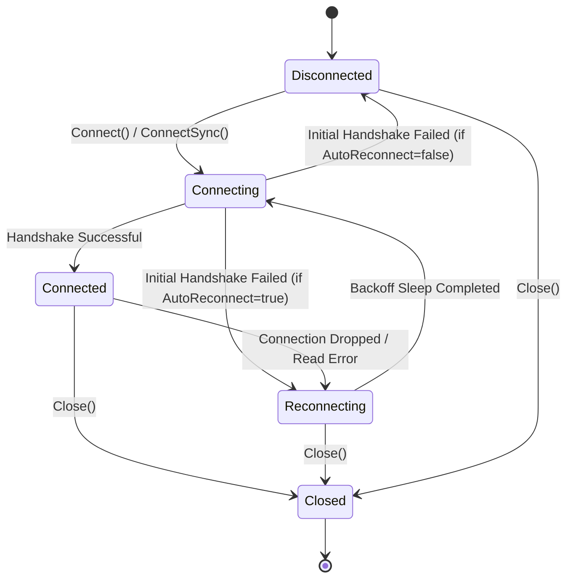

# Package Client (`pkg/client`)

`pkg/client` implements the core WebSocket client for WSBroker with comprehensive mTLS security, background automatic reconnection, channel subscription state persistence, concurrent-safe event dispatching, and stream subscriptions.

## Features

- **Dynamic mTLS Authentication:** Full support for `go.ub.unibas.ch/cloud/certloader/v2` dynamic certificate loaders and standard `*crypto/tls.Config`.
- **Automatic Reconnection with Jittered Exponential Backoff:** Automatically re-establishes dropped connections and re-attaches to all subscribed channels.
- **Dynamic Pub/Sub & Streaming:** Go-channel stream subscriptions (`Subscribe`, `SubscribeTyped[T]`) and handler-based callbacks (`OnChannel`, `OnMessage`, `OnDirect`, `OnType`, `OnEvent`).
- **Generic Strongly-Typed Listeners:** Direct type-safe listeners (`OnTyped[T]`, `OnChannelTyped[T]`, `OnEventTyped[T]`) and streaming subscriptions (`SubscribeTyped[T]`) with fail-fast payload validation.
- **Connection Modes (RW, RO, WO):** Configurable channel access permissions (`ModeRW`, `ModeRO`, `ModeWO`) mapped cleanly onto server routing.
- **Concurrent Safety:** Thread-safe write and state synchronization.
- **Heartbeat & Keepalive:** Automatic Ping/Pong handling and periodic ping dispatch.

---

## State Lifecycle Diagram



---

## Quick Example

```go
package main

import (
    "context"
    "fmt"
    "time"

    "github.com/je4/wsbrokerclient/pkg/client"
    "github.com/je4/wsbrokerclient/pkg/event"
)

type TelemetryData struct {
    Temperature float64 `json:"temperature"`
    Status      string  `json:"status"`
}

func main() {
    ctx := context.Background()

    cli, err := client.New(client.DefaultConfig(),
        client.WithEndpoint("wss://localhost:8080"),
        client.WithClientName("sensor-node-1"),
        client.WithInitialChannels("telemetry", "alerts"),
        client.WithBearerToken("secret-token"),
        client.WithAutoReconnect(true),
    )
    if err != nil {
        panic(err)
    }
    defer cli.Close()

    // 1. Strongly-typed stream subscription
    sub, _ := client.SubscribeTyped[TelemetryData](ctx, cli, "telemetry")
    go func() {
        for evt := range sub.Events() {
            fmt.Printf("Telemetry: temp=%.1f status=%s\n", evt.Data.Temperature, evt.Data.Status)
        }
    }()

    if err := cli.Connect(ctx); err != nil {
        panic(err)
    }

    // 2. Broadcast message
    _ = cli.Broadcast(ctx, "telemetry", TelemetryData{Temperature: 21.5, Status: "nominal"})

    time.Sleep(1 * time.Second)
}
```

---

## Generic Strongly-Typed Listeners & Subscriptions

`pkg/client` provides high-level generic helpers that automatically deserialize incoming `RawEvent` JSON payloads into strongly-typed `*event.Event[T]` structures.

### Typed Event Listeners

- **`client.OnTyped[T](c, eventType, handler, errHandler...)`**: Listens for a specific `EventType` and unmarshals payload directly into `*event.Event[T]`.
- **`client.OnChannelTyped[T](c, channel, handler, errHandler...)`**: Listens for messages dispatched to a channel and unmarshals payload into `*event.Event[T]`.
- **`client.OnEventTyped[T](c, handler, errHandler...)`**: Global listener converting all incoming events into `*event.Event[T]`.

```go
type SensorReading struct {
    SensorID string  `json:"sensor_id"`
    Value    float64 `json:"value"`
}

// Register typed listener for "sensor/reading" event type
unsub := client.OnTyped[SensorReading](cli, "sensor/reading", func(evt *event.Event[SensorReading]) {
    fmt.Printf("Sensor %s: %.2f (source: %s)\n", evt.Data.SensorID, evt.Data.Value, evt.Source)
}, func(raw *event.RawEvent, err error) {
    fmt.Printf("Failed to decode sensor reading from %s: %v\n", raw.Source, err)
})
defer unsub()
```

### Strongly-Typed Subscriptions (`SubscribeTyped`)

`client.SubscribeTyped[T](ctx, c, channel, bufferSize...)` creates a streaming `TypedSubscription[T]` channel returning `<-chan *event.Event[T]`.

```go
sub, err := client.SubscribeTyped[SensorReading](ctx, cli, "sensors")
if err != nil {
    log.Fatal(err)
}
defer sub.Unsubscribe()

for evt := range sub.Events() {
    fmt.Printf("Received sensor reading: %+v\n", evt.Data)
}
```
